<!-- C17 Cyber / original vector graphics. Modify CONTENT in tools/build.py to regenerate the cards. -->

<a href="https://github.com/C17-cyber"></a>

<a href="https://github.com/C17-cyber"><picture><source media="(prefers-color-scheme: dark)" srcset="assets/dark/l-github.svg"/></picture></a>
<a href="https://imortel.fr"><picture><source media="(prefers-color-scheme: dark)" srcset="assets/dark/l-imortel.svg"/></picture></a>
<a href="https://pvp4carry.fr"><picture><source media="(prefers-color-scheme: dark)" srcset="assets/dark/l-pvp4carry.svg"/></picture></a>
<a href="https://www.linkedin.com/in/m%E1%B4%80%CA%80%E1%B4%A1%E1%B4%80%C9%B4/"><picture><source media="(prefers-color-scheme: dark)" srcset="assets/dark/l-linkedin.svg"/></picture></a>

 
<picture><source media="(prefers-color-scheme: dark)" srcset="assets/dark/now.svg"/></picture>
  
<picture><source media="(prefers-color-scheme: dark)" srcset="assets/dark/s01.svg"/>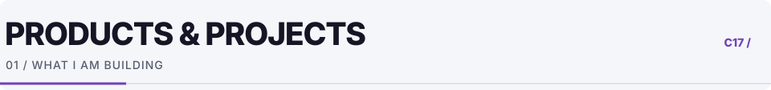</picture>

<a href="https://github.com/C17-cyber"><picture><source media="(prefers-color-scheme: dark)" srcset="assets/dark/p1.svg"/>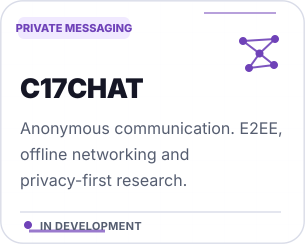</picture></a>
<a href="https://pvp4carry.fr"><picture><source media="(prefers-color-scheme: dark)" srcset="assets/dark/p2.svg"/>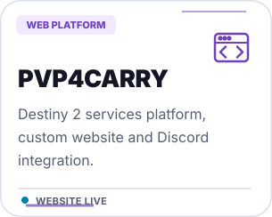</picture></a>
<a href="https://imortel.fr"><picture><source media="(prefers-color-scheme: dark)" srcset="assets/dark/p3.svg"/>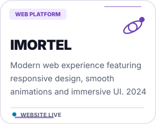</picture></a>

 
<picture><source media="(prefers-color-scheme: dark)" srcset="assets/dark/s02.svg"/>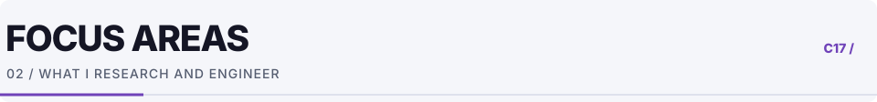</picture>

<picture><source media="(prefers-color-scheme: dark)" srcset="assets/dark/sv1.svg"/>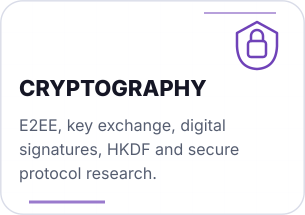</picture>
<picture><source media="(prefers-color-scheme: dark)" srcset="assets/dark/sv2.svg"/>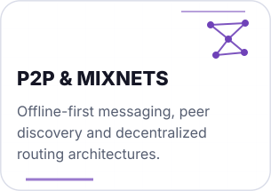</picture>
<picture><source media="(prefers-color-scheme: dark)" srcset="assets/dark/sv3.svg"/>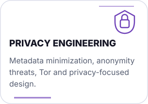</picture>

<picture><source media="(prefers-color-scheme: dark)" srcset="assets/dark/sv4.svg"/>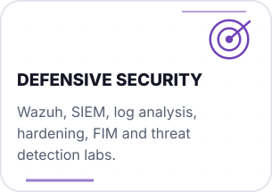</picture>
<picture><source media="(prefers-color-scheme: dark)" srcset="assets/dark/sv5.svg"/>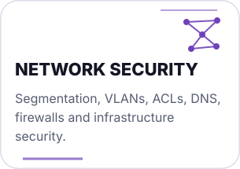</picture>
<picture><source media="(prefers-color-scheme: dark)" srcset="assets/dark/sv6.svg"/>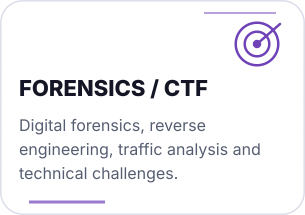</picture>

 
<picture><source media="(prefers-color-scheme: dark)" srcset="assets/dark/s03.svg"/>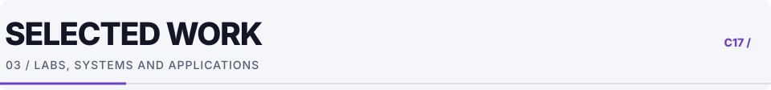</picture>

<picture><source media="(prefers-color-scheme: dark)" srcset="assets/dark/w1.svg"/>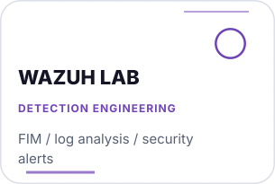</picture>
<picture><source media="(prefers-color-scheme: dark)" srcset="assets/dark/w2.svg"/>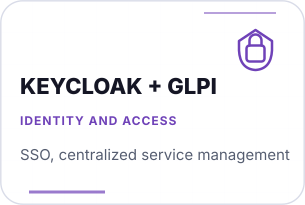</picture>
<picture><source media="(prefers-color-scheme: dark)" srcset="assets/dark/w3.svg"/>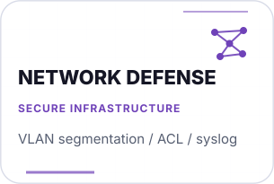</picture>

<picture><source media="(prefers-color-scheme: dark)" srcset="assets/dark/w4.svg"/>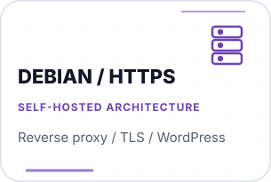</picture>
<picture><source media="(prefers-color-scheme: dark)" srcset="assets/dark/w5.svg"/>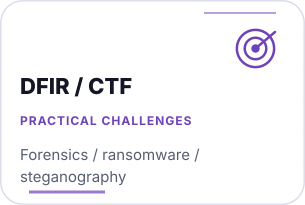</picture>
<picture><source media="(prefers-color-scheme: dark)" srcset="assets/dark/w6.svg"/>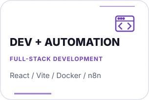</picture>

 
<picture><source media="(prefers-color-scheme: dark)" srcset="assets/dark/s04.svg"/>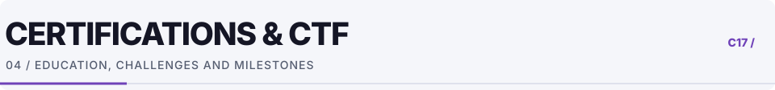</picture>

<picture><source media="(prefers-color-scheme: dark)" srcset="assets/dark/m1.svg"/>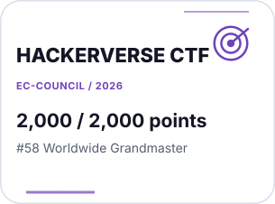</picture>
<picture><source media="(prefers-color-scheme: dark)" srcset="assets/dark/m2.svg"/>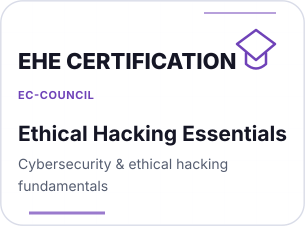</picture>
<picture><source media="(prefers-color-scheme: dark)" srcset="assets/dark/m3.svg"/>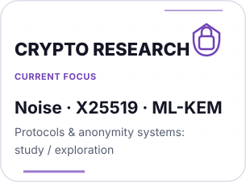</picture>

 
<picture><source media="(prefers-color-scheme: dark)" srcset="assets/dark/s05.svg"/>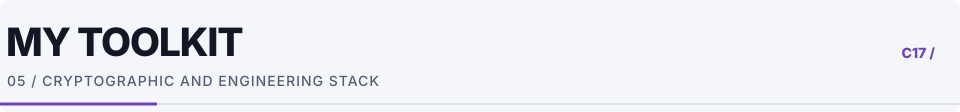</picture>
<picture><source media="(prefers-color-scheme: dark)" srcset="assets/dark/stack.svg"/>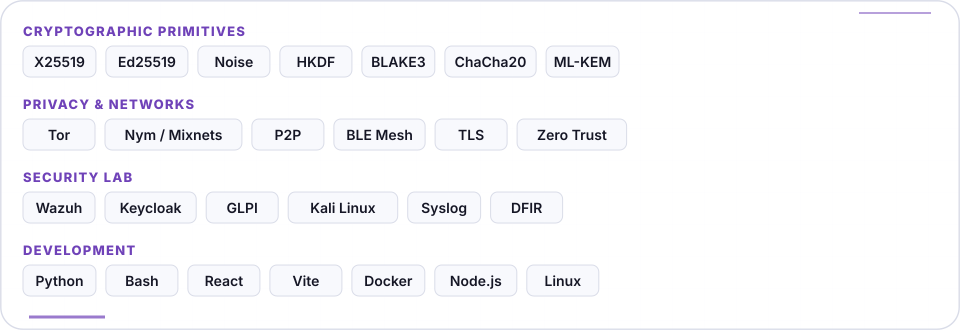</picture>
  
<picture><source media="(prefers-color-scheme: dark)" srcset="assets/dark/s06.svg"/>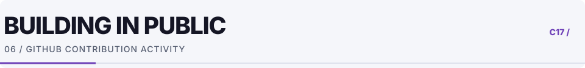</picture>
<picture><source media="(prefers-color-scheme: dark)" srcset="assets/snake-dark.svg"/>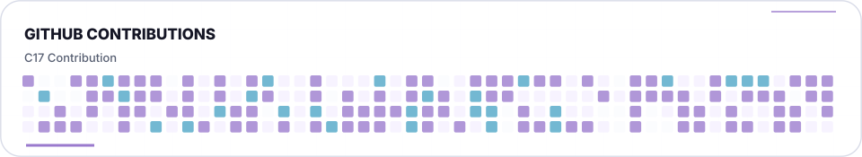</picture>
  
<a href="https://github.com/C17-cyber"><picture><source media="(prefers-color-scheme: dark)" srcset="assets/dark/cta.svg"/>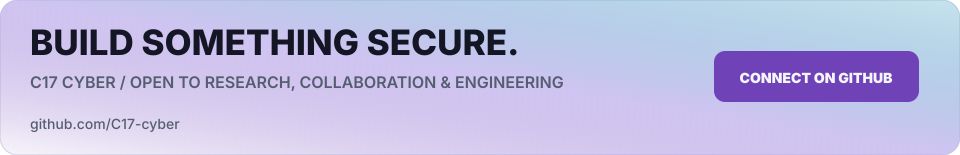</picture></a>

<!-- E2EE and post-quantum algorithm mentions describe research interests, not claims of certified implementation. -->
